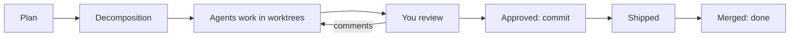

# agent-board

A local task board for AI coding agents. You bring a plan; the board turns it into a graph of tasks, runs a
background Claude Code or Codex agent on each task in its own git worktree, and keeps you in the loop: agents ask
questions, report progress and hand their work to you for review. Nothing is committed without your approval
(unless you turn review off), and nothing is pushed unless you ask.

It is a small Python 3.9+ server with no dependencies and a browser UI that works offline. Everything stays on
your machine.

## Why

Running several coding agents at once quickly turns into juggling terminals. agent-board gives them one place:

- **Plan → tasks.** A skill lays a plan out as tasks with dependencies and checks it against your decomposition
  rules before anything starts.
- **One agent per task.** Each task gets its own worktree and branch; dependent tasks start from their
  dependencies' work. Limits, priorities and a queue keep the machine from drowning.
- **You stay in control.** Questions with options, threads, interrupting a long turn, retrying a failed one,
  inline code review with [crit](https://github.com/tomasz-tomczyk/crit), approval before any commit.
- **A project agent.** It talks to you about the whole project, reads your comments and proposes changes that you
  apply with one button.
- **Shipping and trackers.** Your own ship command (push, pull request, tracker transition), optionally right after
  approval; Jira or GitHub Issues for creating issues and following their statuses; merged tasks close by
  themselves.



## Quick start

Requirements: Python 3.9+, git, and the `claude` or `codex` CLI.

1. **Install the skill.** In Claude Code:

   ```
   /plugin marketplace add ~/path/to/agent-board
   /plugin install agent-board@agent-board-local
   ```

   In Codex: `sh scripts/install-codex.sh` from the repository root.

2. **Install the board** from a fixed commit and put it on `PATH`:

   ```bash
   python3 scripts/install.py
   export PATH="$HOME/.agent-board/bin:$PATH"
   ```

3. **Start your first project.** After writing a plan with your agent, say "put this plan on the board". The skill
   starts the board, creates the project, turns the plan into tasks and gives you a link to the decomposition page.
   Review it, press "Approve breakdown", and the agents start.

   Or by hand:

   ```bash
   agent-board init payments --title "Payments"
   agent-board serve --detach        # prints http://127.0.0.1:8737/?token=…
   ```

From then on everything happens on the board.

## Documentation

See [docs/](docs/README.md):
[installation](docs/installation.md) ·
[how work flows](docs/workflow.md) ·
[review and shipping](docs/review-and-ship.md) ·
[settings](docs/configuration.md) ·
[trackers](docs/trackers.md) ·
[web UI](docs/web-ui.md) ·
[CLI](docs/cli.md) ·
[API](docs/api.md) ·
[security](docs/security.md) ·
[architecture](docs/architecture.md) ·
[development](docs/development.md).

Before giving agents broad permissions, read [Security](docs/security.md): the line between you and the agents
protects against mistakes, not against an agent deliberately acting as you.

## License

MIT, full text in [LICENSE](LICENSE).
