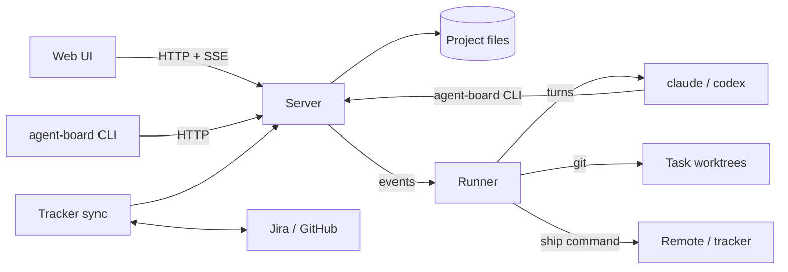

# Architecture

agent-board is one Python package (`board/agent_board`, standard library only) and a browser UI made of plain ES
modules. `agent-board serve` starts three things in one process:

- the **HTTP server**: the JSON [API](api.md), the SSE event stream and the static UI, on `127.0.0.1`;
- the **runner**: listens to board events and turns them into agent turns, runs review rounds, commits, rebases,
  ships and checks merges;
- the **tracker sync** thread (when a tracker is configured).



## Modules

| Module | Role |
|---|---|
| `cli.py` | the `agent-board` command |
| `server.py` | HTTP server, API routes, SSE, static files, token and host checks |
| `board.py` | the board's rules: statuses, actors, dependencies, proposals, settings changes, the event journal |
| `store.py` | files of a project; atomic writes and append-only logs |
| `model.py`, `config.py`, `schema.py` | tasks and statuses; settings and their checks; the settings schema |
| `graph.py` | readiness, display statuses, dependency validation |
| `runner.py`, `wakes.py` | agent sessions, the turn queue and limits, retries, restarts; details for wake-up messages |
| `harness.py`, `fake_agent.py` | launching `claude`, `codex` or the test agent |
| `prompts.py`, `prompts/*.md` | task and project agent prompts |
| `worktree.py` | worktrees, commits, rebases, diffs |
| `review.py` | crit review rounds |
| `ship.py` | the ship command, its queue and placeholders |
| `tracker.py` | Jira and GitHub clients, creating issues, status sync |
| `resources.py` | the `lock-run` resource queues |
| `lifecycle.py`, `install.py` | `serve --detach`, `stop`, `status`; installing from a commit |
| `messages.py` | CLI, board and runner messages in English and Russian |

## Data

`$AGENT_BOARD_HOME` (default `~/.agent-board`):

```
token                     access token
server.json, server.log   the running server: port, pid, version; its log with --detach
bin/agent-board           installed wrapper (scripts/install.py)
runtime/<commit>/         installed code
projects/<slug>/
  project.json            settings
  tasks/<KEY>.json        one file per task
  threads/<thread>.jsonl  conversations (_project is the project thread)
  events.jsonl            the event journal
  proposals.json, meta.json
  logs/                   <KEY>.jsonl (agent turns), <KEY>.review.log, <KEY>.ship.log
  crit/                   review data
```

Task worktrees live next to the code: `<repo>/.agent-board-worktrees/<KEY>`.

## Agents

The runner starts each agent as a background CLI session (`claude` or `codex`) in the task's worktree with
`AGENT_BOARD_ACTOR`, `AGENT_BOARD_TASK`, `AGENT_BOARD_PROJECT` and `AGENT_BOARD_LANG` set. Agents report through the
same `agent-board` CLI: `status`, `update`, `ask`, `say`, `propose`. The prompts (`board/agent_board/prompts/`)
describe these commands, worktree discipline and the review loop; the project's `agent_rules` and `project_brief`
are added to them.

See [How work flows](workflow.md) for the behaviour built on top: stages, queue, interrupts, retries, rebasing.
